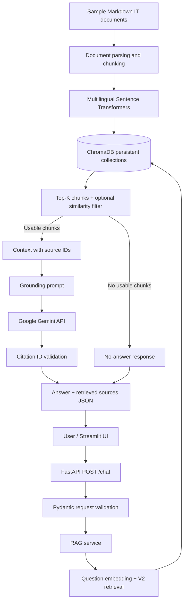

# Enterprise AI Knowledge Assistant

**A multilingual retrieval-augmented generation (RAG) assistant for enterprise IT support documentation.**

Built with **Python, FastAPI, Sentence Transformers, ChromaDB, Google Gemini, and Streamlit**. The application retrieves relevant passages from a local Markdown knowledge base, supplies them as context to an LLM, and returns an answer with document references.

> **Project type:** Educational portfolio prototype using fictional/sample enterprise IT documents. It is not a production-ready enterprise security platform. The Streamlit interface has been run locally; its source file still needs to be committed to this repository if it is not yet present on the remote branch.

## Overview

Enterprise IT guides often describe procedures using specific terminology, while employees ask questions in natural language. A keyword search may miss a relevant passage when its wording differs from the user's question. This project uses multilingual semantic retrieval and a grounded generation prompt to make the documentation easier to search and use.

**Capabilities**

- Parse and chunk Markdown documents covering VPN access, password resets, email support, device onboarding, and information security.
- Generate multilingual sentence embeddings and persist vectors in ChromaDB.
- Compare fixed-window (V1) and structure-aware (V2) chunking without discarding the baseline.
- Retrieve top-K passages, compose structured context, and generate Vietnamese answers with Gemini.
- Serve search and chat through FastAPI; provide a local Streamlit chat interface.
- Expose retrieved document references and apply basic no-answer and citation-ID checks.
- Evaluate retrieval and RAG behavior using labeled examples and automated tests.

## Architecture



The **`/semantic-search` API still defaults to the V1 collection**; the **RAG service explicitly uses V2** (`it_knowledge_base_v2`). A retrieved source is not, by itself, proof that every generated claim is supported by that source.

See [Architecture & design decisions](docs/ARCHITECTURE.md) for the component breakdown, engineering trade-offs, and limitations.

## Technology stack

| Area | Technologies |
| --- | --- |
| Language | Python 3.13 (local development) |
| Backend | FastAPI, Uvicorn, Pydantic |
| LLM | Google Gemini via `google-genai` SDK |
| Embeddings | `sentence-transformers/paraphrase-multilingual-MiniLM-L12-v2` (384 dimensions) |
| Vector storage | ChromaDB persistent local collections, cosine distance |
| UI | Streamlit, HTTPX |
| Configuration | Environment variables, `python-dotenv` |
| Evaluation | Retrieval metrics, labeled JSON datasets, RAG evaluation scripts |
| Testing | Pytest, FastAPI TestClient, monkeypatch |
| Version control | Git / GitHub |

**Deployment:** Local development is supported without Docker. Containerization, hosted deployment, authentication, and access-control enforcement are not claimed as complete.

## Repository layout

```text
enterprise-ai-knowledge-assistant/
├── app/
│   ├── main.py                       # FastAPI endpoints
│   ├── schemas/
│   │   └── chat.py                   # Chat request/response models
│   └── services/
│       ├── document_processor.py     # Fixed-window chunking
│       ├── document_processor_v2.py  # Heading/paragraph-aware chunking
│       ├── embedding_service.py
│       ├── vector_store.py
│       ├── chroma_search.py
│       ├── rag_context.py
│       ├── rag_prompt.py
│       ├── rag_guardrails.py
│       └── rag_service.py
├── frontend/
│   └── streamlit_app.py              # Local Streamlit UI; commit this file if missing remotely
├── sample_docs/                      # Fictional IT knowledge-base Markdown files
├── scripts/                          # Indexing, inspection, retrieval/RAG evaluation
├── evals/
│   ├── questions.json                # Development retrieval questions (10)
│   ├── holdout_questions.json        # Additional retrieval questions (5)
│   ├── rag_eval_questions.json       # RAG evaluation questions (8)
│   ├── metrics.py
│   ├── rag_metrics.py
│   └── reports/
│       ├── rag_eval.json             # Recorded full-run evaluation results
│       └── rag_eval.md               # Human-readable evaluation summary
├── tests/
├── data/chroma/                      # Local ChromaDB data; not committed
├── .env.example
├── .gitignore
├── requirements.txt
└── README.md
```

The layout represents the intended complete local working tree. The remote repository may lag behind files created locally (particularly `frontend/` and readiness/logging work). Only commit files that have actually been created and tested.

## Getting started — Windows PowerShell

Run the following commands **from the repository root**.

### 1. Set up Python

```powershell
py -3.13 -m venv .venv
.\.venv\Scripts\python.exe -m pip install --upgrade pip
.\.venv\Scripts\python.exe -m pip install -r requirements.txt
```

**Dependency check:** At the time this documentation was prepared, the remote `requirements.txt` did not list `chromadb` or `streamlit`. Ensure both packages are listed and use the versions from your tested environment before claiming one-command reproducibility. On a machine where they are missing, install them with:

```powershell
.\.venv\Scripts\python.exe -m pip install chromadb streamlit
.\.venv\Scripts\python.exe -m pip freeze | Select-String '^(chromadb|streamlit)=='
```

Add the displayed versions to `requirements.txt`, then run the tests again.

### 2. Configure Gemini

Copy the example configuration into a local `.env` file:

```powershell
Copy-Item .env.example .env
```

Set your real Gemini key in `.env` (never commit it):

```dotenv
GEMINI_API_KEY=replace_with_a_real_key_locally
GEMINI_MODEL=gemini-3.5-flash-lite
RAG_MIN_SIMILARITY=
```

`RAG_MIN_SIMILARITY` is **optional**. An empty value disables score-based filtering; select a threshold only after evaluating the trade-off between relevant passage retention and out-of-scope rejection. A high similarity score does **not** establish answerability.

### 3. Build local vector indexes

```powershell
.\.venv\Scripts\python.exe -m scripts.build_index
.\.venv\Scripts\python.exe -m scripts.build_index_v2
```

Collection names:

| Collection | Chunking strategy | Use |
| --- | --- | --- |
| `it_knowledge_base` | V1: 100-word windows, 20-word overlap | Retrieval baseline; `/semantic-search` default |
| `it_knowledge_base_v2` | V2: headings/paragraphs; long paragraphs capped at 45 words with 8-word overlap | RAG chat |

The V2 index builder rebuilds its collection. Do not run it unintentionally against a collection holding data you need to preserve.

### 4. Run the backend

Open terminal A:

```powershell
.\.venv\Scripts\python.exe -m uvicorn app.main:app --reload
```

Swagger UI: [http://127.0.0.1:8000/docs](http://127.0.0.1:8000/docs)

### 5. Run the frontend

Open terminal B:

```powershell
.\.venv\Scripts\python.exe -m streamlit run frontend/streamlit_app.py
```

Chat UI: [http://localhost:8501](http://localhost:8501)

The Streamlit application calls FastAPI; keep the backend running in the other terminal. If `frontend/streamlit_app.py` is missing, add/commit the tested local version before trying to run the UI from a clean clone.

## API reference

### `POST /chat`

Request:

```json
{
  "question": "Làm thế nào để kết nối VPN vào mạng nội bộ công ty?",
  "top_k": 3
}
```

Example response **shape** (illustrative, not a recorded output):

```json
{
  "question": "Làm thế nào để kết nối VPN vào mạng nội bộ công ty?",
  "answer": "Mở ứng dụng VPN do IT cung cấp và chọn cấu hình doanh nghiệp... [S1]",
  "sources": [
    {
      "id": "S1",
      "source": "vpn_access.md",
      "chunk_index": 6,
      "score": 0.7898
    }
  ],
  "model": "gemini-3.5-flash-lite"
}
```

The complete response can contain multiple retrieved sources. The `answer` is generated by Gemini; source IDs are assigned from retrieved chunks. When no usable chunk is found, the service returns a no-answer message and may set `model` to `null`.

### Other endpoints

| Method | Path | Purpose |
| --- | --- | --- |
| `GET` | `/` | Welcome message |
| `GET` | `/health` | Process-level health response |
| `GET` | `/documents` | List sample Markdown document files |
| `GET` | `/search?q=...` | Keyword search |
| `POST` | `/semantic-search` | Semantic retrieval; V1 collection by default |
| `POST` | `/chat` | RAG question answering; V2 collection |

The request schema validates length and `top_k` bounds (1–20). Invalid request bodies return HTTP 422. Recognized Gemini SDK API errors are translated to HTTP 502 by the chat endpoint. These behaviors do not replace comprehensive operational error handling.

A `/ready` endpoint and request logging were introduced during local development, but they were **not present in the last checked remote `app/main.py`**; do not advertise them as published until they are committed.

## Retrieval evaluation

The project compares the two chunking variants using labeled **source-level** relevance, not passage-level answer correctness.

### Development set (10 questions)

| Metric | V1 | V2 |
| --- | ---: | ---: |
| Hit@1 | 0.7000 | 1.0000 |
| Hit@3 | 0.8000 | 1.0000 |
| Hit@5 | 0.9000 | 1.0000 |
| Hit@8 | 1.0000 | 1.0000 |
| MRR@8 | 0.7867 | 1.0000 |

### Additional evaluation set (5 questions)

| Metric | V1 | V2 |
| --- | ---: | ---: |
| Hit@3 | 0.8000 | 0.8000 |
| MRR@8 | 0.7000 | 0.8250 |

V2 improved document ranking in these small evaluations; it did **not** improve Hit@3 on the additional set. These results motivated using V2 in RAG while retaining V1 as a baseline.

Reproduce retrieval metrics:

```powershell
.\.venv\Scripts\python.exe -m scripts.evaluate_retrieval --collection it_knowledge_base_v2 --dataset evals/questions.json
.\.venv\Scripts\python.exe -m scripts.evaluate_retrieval --collection it_knowledge_base_v2 --dataset evals/holdout_questions.json
```

## RAG evaluation — recorded results

An **8-question** evaluation run (5 answerable questions, 3 unanswerable questions), using V2, `top_k=3`, and no active minimum-similarity threshold, produced:

| Automated metric | Result | Count |
| --- | ---: | ---: |
| Source Hit Rate | **80.0%** | 4/5 answerable questions |
| Citation ID Valid Rate | **80.0%** | 4/5 answerable questions |
| Unanswerable Refusal Rate | **100.0%** | 3/3 unanswerable questions |

**Key failure:** A question about accessing internal resources from outside the office did not retrieve `vpn_access.md` in the top three. The system returned a no-answer response even though relevant information exists in the knowledge base. This is a retrieval/coverage failure, not evidence that the question is truly unanswerable.

**Interpretation cautions:**

- Citation ID validity verifies only that referenced IDs exist; it does **not** verify claim-to-source entailment.
- The 100% refusal rate covers only **three selected examples**; it is not a deployment-quality guarantee.
- One answerable question contained a partial-refusal-style explanation despite retrieving the expected document; human review of completeness is still required.
- The additional retrieval questions were used in prior analyses, so they are not an untouched independent benchmark.
- Similarity thresholds must be calibrated rather than selected to inflate these scores.

Full results: [RAG evaluation report](evals/reports/rag_eval.md). Raw per-question data: [`rag_eval.json`](evals/reports/rag_eval.json).

Run the evaluation:

```powershell
.\.venv\Scripts\python.exe -m scripts.evaluate_rag
```

For a quick smoke check, `--limit 2` evaluates only two questions; it must not be presented as the full benchmark result. The included optional runner update writes previews to separate filenames to avoid overwriting the full report.

## Testing

```powershell
# All tests
.\.venv\Scripts\python.exe -m pytest -q

# Chat API tests
.\.venv\Scripts\python.exe -m pytest tests/test_chat_api.py -v

# Guardrails / evaluation tests
.\.venv\Scripts\python.exe -m pytest tests/test_rag_guardrails.py tests/test_rag_metrics.py -v
```

FastAPI endpoint tests mock the RAG service; they are designed to be independent of real Gemini calls. Retrieval and generated-answer quality are evaluated separately. A passing test suite should not be reported as evidence of RAG accuracy.

## Demo

See [Demo guide](docs/DEMO_GUIDE.md) for a short, repeatable walkthrough covering VPN guidance, password/account support, and out-of-scope refusal.

A real UI screenshot can be added after capturing it from your running Streamlit application:

```markdown

```

No generated image is presented as a screenshot of the running application.

## Engineering decisions and limitations

**Decisions**

- Keep both chunking variants and compare them using labeled retrieval metrics.
- Use local multilingual embeddings, persistent ChromaDB, and a remotely hosted LLM.
- Keep `/chat` thin; delegate retrieval, prompt building, generation, and guardrails to reusable services.
- Represent source references with `source`, `chunk_index`, and citation IDs.
- Return a no-answer response when no usable context exists or when the generation prompt appropriately refuses.
- Mock Gemini-facing code in endpoint tests to avoid network dependence and usage cost.

**Current limitations**

- No user authentication, per-document authorization, or tenant isolation.
- No production-grade rate limiting, monitoring, or secret management.
- The similarity filter is optional and not robustly calibrated for out-of-scope detection.
- Citation checks validate IDs, not the factual support of individual claims.
- No comprehensive conversation memory: Streamlit UI history does not imply multi-turn context is sent to Gemini.
- No cloud deployment or Docker deployment is claimed.
- Reported metrics are based on small datasets and should not be generalized to enterprise-wide accuracy.

## Security and privacy

Use synthetic or appropriately licensed sample documentation only. Never commit real API keys, passwords, MFA codes, credentials, or confidential company data. Keep `.env`, local vector storage, virtual environments, and caches out of version control. The sample policy document is demonstrative, not an official enterprise security policy.

## Additional documentation

- [Architecture and trade-offs](docs/ARCHITECTURE.md)
- [Demo guide and capture checklist](docs/DEMO_GUIDE.md)
- [Portfolio-ready project description](docs/PROJECT_PORTFOLIO.md)
- [RAG evaluation report](evals/reports/rag_eval.md)

---

**Status:** Working educational RAG backend with locally tested Streamlit UI and a measured small-sample evaluation. Further work should prioritize retrieval failures, citation support verification, and robust access control before any real enterprise rollout.
