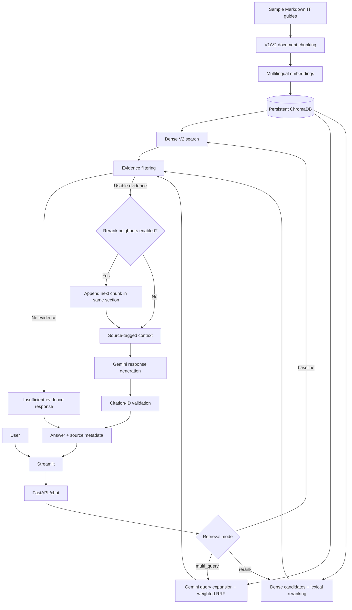

# Enterprise AI Knowledge Assistant

[](https://github.com/bryandhpir/enterprise-ai-knowledge-assistant/actions/workflows/ci.yml)

**A multilingual Retrieval-Augmented Generation (RAG) assistant for enterprise IT support knowledge.**

A local-first Python application that retrieves relevant passages from **fictional, sample IT documentation** with Sentence Transformers and ChromaDB, then uses **Google Gemini** to generate Vietnamese answers with source references. FastAPI powers the API, Streamlit provides the chat interface, and Docker Compose orchestrates both services and persistent storage.

> **Project scope:** An educational AI engineering portfolio prototype, not a production-secure enterprise service or a publicly hosted application. Do not upload actual company documents or secrets.

## Demo


The chat UI displays responses, source filenames, anchor chunk IDs, original-query similarity scores, and any neighboring chunk IDs included as additional evidence. Browser-session chat history is **not** sent as multi-turn conversation context to Gemini.

## Highlights

- **Document ingestion:** Five Markdown IT guides about account recovery, VPN, email, device setup, and information security.
- **Chunking experiments:** Fixed-size V1 versus heading/paragraph-aware V2, with source metadata.
- **Semantic retrieval:** Multilingual embeddings and a persistent ChromaDB vector database.
- **Three retrieval modes:** `baseline`, `multi_query`, and `rerank`, selected through an environment variable.
- **Multi-Query (experimental):** Gemini generates search paraphrases; weighted Reciprocal Rank Fusion (RRF) merges rankings while preserving the original question.
- **Passage reranking:** A lightweight, BM25-style lexical signal combined with original-question cosine similarity ranks a wider candidate pool. No additional neural reranker is required.
- **Neighboring context (optional):** Appends the next chunk **only when it belongs to the same Markdown section**, retaining the anchor's rank and score and reporting the complete evidence span.
- **Grounded answers:** Source-tagged prompts, conservative no-answer behavior, optional cosine threshold, and citation-ID validation.
- **Engineering workflow:** FastAPI, Streamlit, Pytest, Docker Compose, persistent volumes, and GitHub Actions CI.
- **Evaluation:** Retrieval and passage-level metrics, end-to-end answer/refusal checks, and manual answer-quality reviews with limitations documented.

## Architecture



The neighboring-context option applies **only to `rerank`**. It adds evidence to selected passages, not extra ranked results. Gemini remains an external API dependency; embeddings and ChromaDB run locally.

### Chunking and collections

| Collection | Approach | Used for |
| --- | --- | --- |
| `it_knowledge_base` | V1 fixed windows: **60 words**, 20-word overlap (current code defaults) | Historical baseline and default `/semantic-search` |
| `it_knowledge_base_v2` | V2 Markdown-aware passages; long paragraphs: up to **45 words**, 8-word overlap, title/heading context | Chat, retrieval experiments, reranking |

**Reproducibility caution:** Some historical notes describe 100-word V1 windows, whereas the current implementation defaults to 60. Historical V1/V2 results were not re-established under a verified identical V1 configuration. V2 also changes the text embedded, not merely chunk length.

### Retrieval strategies

| Mode | Implementation | Trade-off |
| --- | --- | --- |
| `baseline` | Original query → V2 semantic Top-K | Simple, no query-rewrite cost; can miss relevant passages |
| `multi_query` | Original query + up to two generated variants → weighted RRF | May recover indirectly phrased questions; adds API calls and intent-drift risk |
| `rerank` | Dense candidate retrieval → combined lexical/cosine ranking → Top-K | Improved passage ranking on development cases; weight/candidate tuning is dataset-specific |
| `rerank` + neighbors | Rerank, then append the next chunk from the same section | Better context continuity; additional text and variable generation latency |

Configuration defaults in code: `baseline`, **80 rerank candidates**, lexical weight **0.65**, and neighboring context **disabled** until enabled explicitly. The reported `score` remains original-question cosine similarity. RRF and rerank scores are **ranking signals**, not probabilities or interchangeable similarity values.

Read [architecture notes](docs/ARCHITECTURE.md), [reranking guide](docs/PASSAGE_RERANKING_GUIDE.md), [configuration guide](docs/RERANK_CONFIGURATION.md), and [neighboring context guide](docs/NEIGHBOR_CONTEXT_GUIDE.md).

## Technology stack

| Layer | Technology |
| --- | --- |
| Language | Python 3.13 |
| API | FastAPI, Pydantic, Uvicorn |
| Chat UI | Streamlit, HTTPX |
| Embeddings | `sentence-transformers/paraphrase-multilingual-MiniLM-L12-v2` (384-dimension vectors, CPU) |
| Vector store | ChromaDB `PersistentClient` with cosine distance |
| Generation / query expansion | Google Gemini via `google-genai` |
| Reranking | BM25-style lexical relevance + normalized cosine similarity |
| Packaging | Docker, Docker Compose, persistent named volumes |
| Tests / CI | Pytest, GitHub Actions |

## Run locally with Docker Compose

**Requirements:** Git, Docker Desktop with a functioning Linux engine, sufficient space for Python/ML dependencies, and your own Gemini API key. The first build and model download can be large.

### 1. Clone and configure

```powershell
git clone https://github.com/bryandhpir/enterprise-ai-knowledge-assistant.git
cd enterprise-ai-knowledge-assistant
Copy-Item .env.example .env
```

Set your own `GEMINI_API_KEY` in `.env`. **Never commit `.env`, credentials, or real internal company documents.** If using the optimized demo, add/update these settings in `.env`:

```dotenv
RAG_RETRIEVAL_MODE=rerank
RAG_RERANK_CANDIDATES=80
RAG_RERANK_LEXICAL_WEIGHT=0.65
RAG_CONTEXT_NEIGHBORS=true
```

For a direct semantic-search baseline, use `RAG_RETRIEVAL_MODE=baseline`. For an experimental generated-query comparison, use `multi_query`. To test reranking without neighbor expansion, set `RAG_CONTEXT_NEIGHBORS=false`. All modes use the same V2 ChromaDB collection.

### 2. Build Docker image and prepare volumes

```powershell
docker compose build api
```

The container runs as a non-root `appuser` (UID 10001). On a fresh setup, prepare the Hugging Face cache and vector-store volume permissions **before the first indexing run**:

```powershell
docker compose run --rm --no-deps --user root api chown -R 10001:10001 /home/appuser/.cache/huggingface /app/data/chroma
```

This one-time step should not be repeated unnecessarily on an installation that already works.

### 3. Index the sample documents

```powershell
docker compose run --rm --no-deps api python -m scripts.build_index
docker compose run --rm --no-deps api python -m scripts.build_index_v2
```

V1 and V2 occupy different ChromaDB collections. The V2 indexing script clears and rebuilds the **V2 collection**; don't rerun it if you are trying to preserve a previously indexed custom corpus. Docker named volumes preserve the model cache and database between ordinary container restarts.

### 4. Launch and verify

```powershell
docker compose up -d
docker compose ps
Invoke-RestMethod http://127.0.0.1:8001/health
Invoke-RestMethod http://127.0.0.1:8001/ready
```

| Service | Host URL |
| --- | --- |
| Streamlit chatbot | http://127.0.0.1:8501 |
| FastAPI OpenAPI / Swagger UI | http://127.0.0.1:8001/docs |
| Health probe | http://127.0.0.1:8001/health |
| Readiness probe | http://127.0.0.1:8001/ready |

Port mapping is **host 8001 → container 8000**. Within Compose, Streamlit contacts `http://api:8000/chat`. The readiness probe checks local configuration and V2 index presence; it **does not** verify that a Gemini API call will succeed.

### 5. Stop and troubleshoot

```powershell
docker compose logs --tail=80 api
docker compose logs --tail=80 frontend
docker compose down
# Later: restart without erasing data
docker compose up -d
```

**Do not run `docker compose down -v`** when you need your ChromaDB index and model cache: `-v` removes Compose-managed named volumes. If a port is occupied, edit the host port in `compose.yaml`. If model downloads fail with `PermissionError` under `/home/appuser/.cache/huggingface`, review the volume-ownership step above.

## Alternative: Python on Windows

```powershell
py -3.13 -m venv .venv
.\.venv\Scripts\python.exe -m pip install --upgrade pip
.\.venv\Scripts\python.exe -m pip install -r requirements.txt
Copy-Item .env.example .env
```

Configure `.env`, then build indexes:

```powershell
.\.venv\Scripts\python.exe -m scripts.build_index
.\.venv\Scripts\python.exe -m scripts.build_index_v2
```

Start FastAPI and Streamlit in separate PowerShell windows:

```powershell
# Terminal A
.\.venv\Scripts\python.exe -m uvicorn app.main:app --reload
```

```powershell
# Terminal B
.\.venv\Scripts\python.exe -m streamlit run frontend/streamlit_app.py
```

Without Docker, FastAPI uses port 8000 by default. Avoid launching another service on the same host port.

## API

| Method | Endpoint | Behavior |
| --- | --- | --- |
| GET | `/` | API welcome |
| GET | `/health` | Process health |
| GET | `/ready` | Configured key and nonempty V2 index (503 otherwise) |
| GET | `/documents` | List sample document files |
| GET | `/search?q=...` | Keyword search |
| POST | `/semantic-search` | Semantic retrieval (defaults to V1) |
| POST | `/chat` | V2 RAG with selected retrieval mode |

Example `/chat` request:

```json
{
  "question": "Làm thế nào để kết nối VPN vào mạng nội bộ công ty?",
  "top_k": 3
}
```

Responses include `question`, `answer`, `sources`, and `model`. Each source has an ID, filename, anchor chunk index, and original-query similarity score; when neighbors were appended, it may include `context_chunk_indices`. The Streamlit UI supports `top_k` 1–8; the API accepts 1–20.

## Evaluation and results

The following results come from **small, curated development sets** and local runs. They are useful engineering diagnostics, **not** independent benchmarks, guarantees of future accuracy, or proof of citation-level factual correctness. Gemini outputs and latency vary between calls.

### Historical chunking and retrieval measurements

| Dataset | Metric | V1 | V2 |
| --- | --- | ---: | ---: |
| Development (10 questions) | Hit@1 | 70% | 100% |
| Development (10 questions) | Hit@3 | 80% | 100% |
| Development (10 questions) | MRR@8 | 0.7867 | 1.0000 |
| Additional (5 questions) | Hit@3 | 80% | 80% |
| Additional (5 questions) | MRR@8 | 0.7000 | 0.8250 |

Older [retrieval logs](evals/baseline.txt) and [V2 logs](evals/v2.txt) record these experiments. The additional questions were subsequently used during development, so they must not be described as an untouched holdout.

### Reranking: passage-level relevance

A development exercise with eight answerable cases showed **Passage Hit@3** increasing from **5/8 (62.5%)** with dense retrieval to **8/8 (100%)** using **80 candidates** and a **0.65 lexical weight**. MRR@3 for the tuned configuration was **0.7917**, versus **0.4583** for dense retrieval. This is a later local evaluation; the currently committed [`passage_rerank_eval.json`](evals/reports/passage_rerank_eval.json) records an **earlier** reranking run (7/8, 87.5%) and should be regenerated/synchronized before treating it as the tuned-config report.

### End-to-end RAG comparison (12 curated cases)

Eight questions are answerable from the sample documents; four are out of scope. All values below are **single-run observations** and exact-match refusal checks use the configured fallback wording.

| Metric | Baseline | Rerank (80 / 0.65) |
| --- | ---: | ---: |
| Source Hit Rate (8 answerable) | 100% | 100% |
| Valid Citation ID Rate (8 answerable) | 62.5% | 100% |
| Exact-match Correct Refusal (4 unanswerable) | 100% | 100% |
| Mean response latency (12 cases) | 5.749 s | 4.143 s |
| Execution errors | 0 | 0 |

Full artifacts: [rerank end-to-end JSON](evals/reports/rerank_e2e_comparison.json), [summary](evals/reports/rerank_e2e_comparison.md), [manual review](docs/RERANK_MANUAL_REVIEW.md).

### Neighboring context: same-section evidence

| Metric | Rerank alone | Rerank + next chunk |
| --- | ---: | ---: |
| Source Hit Rate (8 answerable) | 100% | 100% |
| Valid Citation ID Rate (8 answerable) | 100% | 100% |
| Exact-match Correct Refusal (4 unanswerable) | 75% | 100% |
| Mean latency (12 cases) | 7.526 s | 10.727 s |
| Execution errors | 0 | 0 |

The last mean includes a **75.308-second outlier** for one request with neighbors enabled. These single-run differences do not prove that one configuration is reliably faster. The rerank-alone U02 case returned a **citation-validation fallback**, not disclosed credentials; because it did not match the configured no-answer phrase, the exact-match refusal metric counted it as a failure.

The additional same-section chunk improved completeness on two targeted cases: MFA recovery (`password_reset.md`, chunks 14–15) and device handover (`device_setup.md`, chunks 16–17). The results do **not** establish automatic claim-level verification or access control.

Artifacts: [neighbor comparison JSON](evals/reports/neighbor_context_comparison.json), [summary](evals/reports/neighbor_context_comparison.md), [manual quality review](docs/NEIGHBOR_CONTEXT_MANUAL_REVIEW.md).

### Evaluation limitations

- **Source Hit** checks that an expected filename occurs, not whether the exact passage is sufficient.
- **Citation ID valid** means referenced IDs exist; it does **not** prove each claim is supported by the passage.
- **Exact-match refusal** measures a specific fallback string. Other safe refusals may be counted as failures.
- Development-question tuning, generation variability, and limited sample size prevent general performance claims.
- Sensitive-information detection in the experimental Multi-Query mode is a conservative heuristic, **not** authentication, authorization, or comprehensive safety filtering.

## Automated testing and CI

```powershell
.\.venv\Scripts\python.exe -m pytest -q
# If the Docker image contains the current code:
docker compose exec -T api python -m pytest -q
```

[GitHub Actions](.github/workflows/ci.yml) executes Python 3.13 Pytest on push/PR events targeting `main`. The Docker image build job runs on **push to `main`** or manual dispatch, **not on pull requests**. Tests use mocks where appropriate and do not represent live Gemini end-to-end evaluation.

## Repository structure

```text
enterprise-ai-knowledge-assistant/
├── .github/workflows/ci.yml
├── app/
│   ├── main.py
│   ├── schemas/chat.py
│   └── services/
│       ├── rag_service.py
│       ├── chroma_search.py
│       ├── multi_query_retrieval.py
│       ├── lexical_reranker.py
│       └── neighbor_context.py
├── frontend/streamlit_app.py
├── sample_docs/
├── scripts/                       # Ingestion, experiments, diagnostics, evaluation
├── evals/                         # Labeled questions and recorded reports
├── tests/                         # Unit / API / retrieval tests
├── docs/                          # Architecture, experiment guides, reviews
│   └── image/chatbotdemo.png
├── Dockerfile
├── compose.yaml
├── .dockerignore
├── .env.example
├── requirements.txt
└── README.md
```

## Security and known limitations

- **Not production ready:** No user authentication, per-document permissions, tenant isolation, production rate limiting, or full audit trail.
- Do not process real company documents, personal data, passwords, or API keys as corpus content.
- Source tagging and citation-ID validation do not guarantee factual correctness or prevent all unsupported answers.
- The optional cosine threshold is not calibrated; vector retrieval always returns nearest matches even for unrelated queries.
- Streamlit session history does not make the backend a multi-turn conversational memory system.
- Deployment is local with Docker Compose. CI is implemented; **automatic public cloud deployment is not**.

Future work could include an independent evaluation set, calibrated relevance/abstention checks, authenticated access, claim-level verification, observability, and deployment automation.

## Additional documentation

- [Architecture & engineering decisions](docs/ARCHITECTURE.md)
- [Demo guide](docs/DEMO_GUIDE.md)
- [Project portfolio description](docs/PROJECT_PORTFOLIO.md)
- [Multi-Query notes](docs/MULTI_QUERY_INTEGRATION.md)
- [Reranking guide](docs/PASSAGE_RERANKING_GUIDE.md)
- [Rerank configuration](docs/RERANK_CONFIGURATION.md)
- [Neighbor context guide](docs/NEIGHBOR_CONTEXT_GUIDE.md)
- [Reranking manual quality review](docs/RERANK_MANUAL_REVIEW.md)
- [Neighbor-context manual quality review](docs/NEIGHBOR_CONTEXT_MANUAL_REVIEW.md)

---

**Status:** Locally tested RAG portfolio prototype with configurable retrieval, reranking, optional neighboring context, Docker Compose, saved evaluation evidence, automated tests, and GitHub Actions CI.
