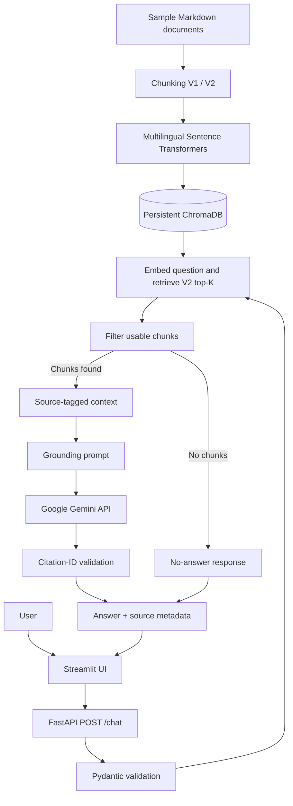

# Enterprise AI Knowledge Assistant

**A multilingual Retrieval-Augmented Generation (RAG) assistant for enterprise IT knowledge.**

The application searches sample internal IT documentation with multilingual embeddings and ChromaDB, then uses Google Gemini to generate Vietnamese answers with document references. **FastAPI** provides the API and **Streamlit** provides a local chat interface.

> **Scope:** This is a portfolio/educational prototype built with sample documentation, not a production-ready enterprise system. It runs locally; Docker and cloud deployment are not required or currently provided.

## Demo


The UI accepts IT-support questions, displays generated responses and exposes the retrieved sources, including document names, chunk indexes and similarity scores. Chat messages persist within the Streamlit session, but previous turns are **not** passed to the model as conversational context.

## Features

- **Document ingestion:** Read five Markdown IT guides covering VPN, passwords, email, device setup and security policies.
- **Two chunking strategies:** Compare fixed-window chunks with Markdown heading/paragraph-aware chunks.
- **Multilingual semantic search:** Generate embeddings with `sentence-transformers/paraphrase-multilingual-MiniLM-L12-v2` and query persistent ChromaDB collections.
- **Grounded answer generation:** Construct source-tagged context (`[S1]`, `[S2]`, …) for Gemini and return an answer with retrieved-source metadata.
- **Basic guardrails:** Filter empty passages, optionally apply a similarity threshold, provide an insufficient-evidence fallback and check that cited IDs exist in retrieved sources.
- **API and UI:** Expose FastAPI endpoints and a Streamlit interface with configurable `top_k` and session chat history.
- **Evaluation and tests:** Compare retrieval rankings, record RAG outcomes and run automated Pytest checks without making live Gemini calls during API unit tests.

## Architecture



**Retrieval configuration:**

| Collection | Current implementation | Used by |
| --- | --- | --- |
| `it_knowledge_base` (V1) | Fixed-word windows; `split_text()` defaults to **60 words with 20-word overlap** | Baseline indexing and `/semantic-search` |
| `it_knowledge_base_v2` (V2) | Heading/paragraph-aware chunks; long paragraphs split at **45 words with 8-word overlap**, enriched with heading context | `/chat` RAG pipeline |

**Important reproducibility note:** Earlier experimental notes describe a 100-word V1 configuration, whereas the **current repository code defaults to 60 words**. The saved baseline figures are historical results and should not be assumed to reproduce exactly from a newly built V1 index without verifying the original settings. No evaluation scores were recalculated for this README.

For more detail, see [Architecture and engineering decisions](docs/ARCHITECTURE.md).

## Tech stack

| Layer | Tools |
| --- | --- |
| Language | Python 3.13 (local development environment) |
| API | FastAPI, Pydantic, Uvicorn |
| Frontend | Streamlit, HTTPX |
| Embedding model | `sentence-transformers/paraphrase-multilingual-MiniLM-L12-v2` (384-dimensional vectors) |
| Vector store | ChromaDB, local persistent collections with cosine distance |
| Generation | Google Gemini via `google-genai` SDK |
| Configuration | `.env`, `python-dotenv` |
| Evaluation / testing | Custom retrieval and RAG scripts, Pytest, FastAPI TestClient |

## Quick start — Windows PowerShell

All commands below are run **from the repository root**. A Gemini API key and an internet connection are needed for answer generation and the initial embedding-model download.

### 1. Clone and install

```powershell
git clone https://github.com/bryandhpir/enterprise-ai-knowledge-assistant.git
cd enterprise-ai-knowledge-assistant

py -3.13 -m venv .venv
.\.venv\Scripts\python.exe -m pip install --upgrade pip
.\.venv\Scripts\python.exe -m pip install -r requirements.txt
```

The committed requirements include `chromadb` and `streamlit`. A CPU-based embedding model is used; the first model load can download weights and take longer than later runs.

### 2. Configure environment variables

```powershell
Copy-Item .env.example .env
```

Edit the **local** `.env` file:

```dotenv
GEMINI_API_KEY=your_own_gemini_api_key
GEMINI_MODEL=gemini-3.5-flash-lite
RAG_MIN_SIMILARITY=
LOG_LEVEL=INFO
```

| Variable | Purpose |
| --- | --- |
| `GEMINI_API_KEY` | Required for Gemini generation; never commit the real value |
| `GEMINI_MODEL` | Model identifier passed to the Google GenAI SDK |
| `RAG_MIN_SIMILARITY` | Optional minimum retrieval score (`0`–`1`); leave empty to disable |
| `LOG_LEVEL` | Application logging level; defaults to `INFO` |

The example model name reflects the repository configuration; access depends on the models available to your Gemini account. The similarity score is **not** the probability that an answer is correct, and no universal threshold has been validated.

### 3. Build the local indexes

```powershell
.\.venv\Scripts\python.exe -m scripts.build_index
.\.venv\Scripts\python.exe -m scripts.build_index_v2
```

Indexes are stored under `data/chroma/`, which is excluded from Git. The V2 builder **replaces records in its V2 collection** when rerun; the V1 builder uses upsert and does not automatically remove stale IDs for documents deleted from the corpus.

### 4. Run the API and chat UI

**Terminal A — FastAPI**

```powershell
.\.venv\Scripts\python.exe -m uvicorn app.main:app --reload
```

Open the [API documentation](http://127.0.0.1:8000/docs).

**Terminal B — Streamlit**

```powershell
.\.venv\Scripts\python.exe -m streamlit run frontend/streamlit_app.py
```

Open the chat at **http://localhost:8501**. Keep both terminals running; Streamlit sends HTTP requests to the local FastAPI backend.

### 5. Try a question

Ask in Streamlit:

> Làm thế nào để kết nối VPN vào mạng nội bộ công ty?

The answer should use applicable documentation and include citation markers when the model provides source-grounded information. Actual wording and retrieval ranks can vary. You can also ask an out-of-scope question, such as one about live market prices, to inspect refusal behavior; correct refusal is **not guaranteed for all prompts**.

## API reference

| Method | Endpoint | Description |
| --- | --- | --- |
| `GET` | `/` | Welcome message |
| `GET` | `/health` | Basic process health check |
| `GET` | `/ready` | Check for a configured Gemini key and non-empty V2 collection; returns HTTP 503 otherwise |
| `GET` | `/documents` | List Markdown documents in `sample_docs/` |
| `GET` | `/search?q=...` | Keyword-based document search |
| `POST` | `/semantic-search` | ChromaDB semantic search (V1 by default) |
| `POST` | `/chat` | V2 retrieval + Gemini RAG response |

**Example `POST /chat` request:**

```json
{
  "question": "Làm thế nào để kết nối VPN vào mạng nội bộ công ty?",
  "top_k": 3
}
```

**Response structure** (illustrative; not a recorded model output):

```json
{
  "question": "Làm thế nào để kết nối VPN vào mạng nội bộ công ty?",
  "answer": "Hãy tham khảo hướng dẫn VPN trong tài liệu nội bộ. [S1]",
  "sources": [
    {
      "id": "S1",
      "source": "vpn_access.md",
      "chunk_index": 2,
      "score": 0.75
    }
  ],
  "model": "gemini-3.5-flash-lite"
}
```

The real response may include more sources or a no-answer fallback. The API accepts `top_k` from 1 to 20; the Streamlit slider exposes 1 to 8. Pydantic rejects invalid chat requests with HTTP 422; recognized Gemini API errors are mapped to HTTP 502.

`/health` does not test external dependencies. `/ready` checks configuration and local index contents, **not** whether Gemini is currently reachable or the key is valid.

## Evaluation

The repository includes **historical retrieval comparisons** and a **recorded RAG evaluation**. These are small, source-labeled experiments rather than claims of production accuracy.

### Retrieval: V1 vs V2

| Dataset | Metric | V1 recorded | V2 recorded |
| --- | --- | ---: | ---: |
| Development (10 questions) | Hit@1 | 70.0% | 100.0% |
| Development (10 questions) | Hit@3 | 80.0% | 100.0% |
| Development (10 questions) | MRR@8 | 0.7867 | 1.0000 |
| Additional (5 questions) | Hit@3 | 80.0% | 80.0% |
| Additional (5 questions) | MRR@8 | 0.7000 | 0.8250 |

Saved development logs: [`evals/baseline.txt`](evals/baseline.txt) and [`evals/v2.txt`](evals/v2.txt). The additional questions have since been used in further analyses and should not be described as an untouched holdout benchmark.

Run retrieval evaluations using the **currently indexed collections**:

```powershell
.\.venv\Scripts\python.exe -m scripts.evaluate_retrieval --collection it_knowledge_base --dataset evals/questions.json
.\.venv\Scripts\python.exe -m scripts.evaluate_retrieval --collection it_knowledge_base_v2 --dataset evals/questions.json
.\.venv\Scripts\python.exe -m scripts.evaluate_retrieval --collection it_knowledge_base_v2 --dataset evals/holdout_questions.json
```

### RAG evaluation: 8 recorded questions

Collection: `it_knowledge_base_v2` · `top_k=3` · similarity threshold disabled.

| Metric | Recorded result | Cases |
| --- | ---: | ---: |
| Source Hit Rate | **80.0%** | 4 / 5 answerable questions |
| Valid Citation ID Rate | **80.0%** | 4 / 5 answerable questions |
| Correct Refusal Rate | **100.0%** | 3 / 3 selected unanswerable questions |

**Observed failure:** A question about accessing internal resources away from the office did not retrieve `vpn_access.md` in the top three, despite relevant information existing in the corpus. The system therefore returned an insufficient-information response. This is a retrieval-coverage failure, not proof that the question lacks an answer.

**Metric caveats:** Source Hit checks source filenames, not individual passages. Citation-ID validation checks whether cited identifiers exist, **not whether each claim is supported** by its cited passage. Completeness and claim-level groundedness still require human review; results may vary on reruns.

See the [evaluation report](evals/reports/rag_eval.md) and [per-question raw results](evals/reports/rag_eval.json).

```powershell
# Full run: calls Gemini and writes rag_eval.json / rag_eval.md
.\.venv\Scripts\python.exe -m scripts.evaluate_rag

# Preview run: saved separately from the full report
.\.venv\Scripts\python.exe -m scripts.evaluate_rag --limit 2
```

## Testing

```powershell
.\.venv\Scripts\python.exe -m pytest -q
```

The `tests/` suite covers document processing, metrics, FastAPI endpoints, schema validation, citation-ID checks and readiness behavior. API tests mock the generation service where applicable; passing these tests **does not** establish that all generated answers are correct.

## Repository structure

```text
enterprise-ai-knowledge-assistant/
├── app/
│   ├── main.py                     # FastAPI routes, logging, readiness
│   ├── schemas/chat.py            # Request and response models
│   └── services/                  # Chunking, embeddings, ChromaDB, RAG
├── frontend/streamlit_app.py      # Streamlit chat UI
├── sample_docs/                   # Five fictional IT-support guides
├── scripts/                       # Index building and evaluation tools
├── evals/                         # Datasets, metrics and saved reports
├── tests/                         # Automated Pytest suite
├── docs/                          # Architecture, demo and portfolio notes
│   └── image/chatbotdemo.png      # Actual UI screenshot
├── .env.example                   # Safe example configuration
├── .gitignore
├── requirements.txt
└── README.md
```

## Security, limitations and next steps

The sample knowledge base is designed for a demo. **Do not upload real credentials, private corporate documents or sensitive customer data.** `.env`, virtual environments and local ChromaDB data are ignored by Git; always check staged changes before committing.

Current limitations include:

- No authentication, permission-aware document retrieval or tenant isolation.
- No production rate limiting, secret-management system or comprehensive monitoring.
- No verified claim-level attribution; citation checks only validate reference IDs.
- Out-of-scope detection depends on context and prompt behavior; the optional similarity threshold is not calibrated.
- Streamlit session history is **not** multi-turn model memory.
- No Docker-based or public cloud deployment is claimed.

Promising engineering improvements are stronger retrieval for paraphrased queries (e.g. the remote-access failure), hybrid search or reranking, passage-level evaluation and evidence-grounding verification.

## Documentation

- [Architecture & engineering decisions](docs/ARCHITECTURE.md)
- [Demo walkthrough](docs/DEMO_GUIDE.md)
- [Portfolio / CV project description](docs/PROJECT_PORTFOLIO.md)
- [RAG evaluation report](evals/reports/rag_eval.md)

---

**Status:** Functional local RAG prototype with FastAPI, Streamlit, ChromaDB V2, Gemini generation, automated tests and saved small-sample evaluation results.
