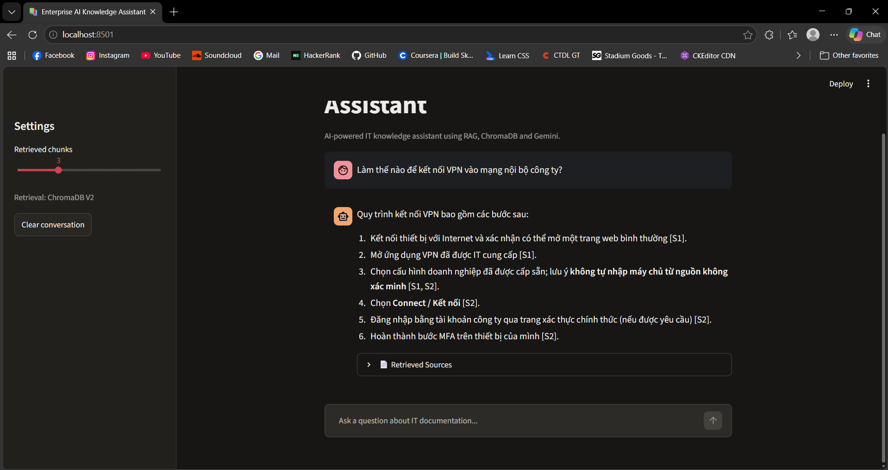
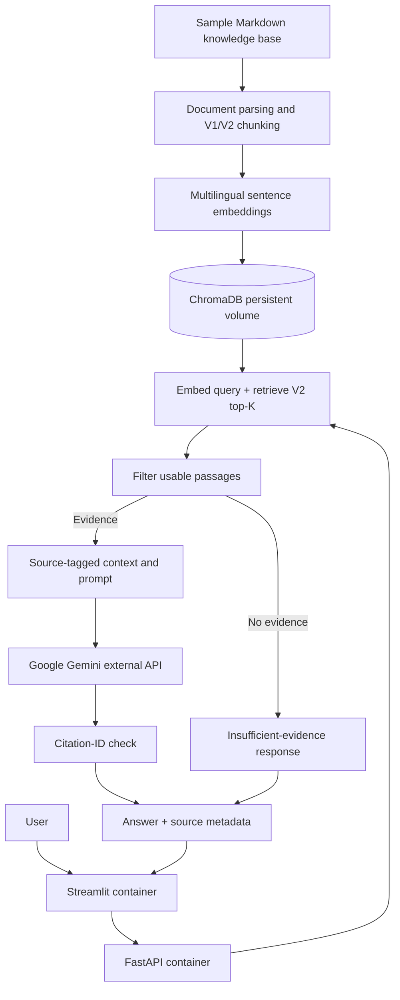

# Enterprise AI Knowledge Assistant

[](https://github.com/bryandhpir/enterprise-ai-knowledge-assistant/actions/workflows/ci.yml)

**A multilingual Retrieval-Augmented Generation (RAG) assistant for enterprise IT support documentation.**

A Python application that retrieves relevant passages from sample Markdown knowledge articles with multilingual sentence embeddings and **ChromaDB**, then uses **Google Gemini** to generate Vietnamese answers with source references. **FastAPI** serves the API, **Streamlit** provides a chat interface, and **Docker Compose** runs both services locally.

> **Scope:** Educational/portfolio prototype using fictional IT documentation. Docker Compose and GitHub Actions CI are implemented; this is **not** a production-secure enterprise system or a publicly hosted service.

## Demo



The UI shows generated answers, retrieved document names, chunk indexes and similarity scores. Streamlit retains messages during the browser session; previous turns are **not** passed to Gemini as conversational context.

## Features

- Read and chunk five sample IT guides (VPN, password reset, email, device setup, and security policy).
- Compare fixed-window (V1) and Markdown-aware (V2) chunking strategies.
- Create normalized multilingual embeddings with Sentence Transformers and retrieve passages from persistent ChromaDB collections.
- Use source-tagged evidence and a grounding prompt to generate Vietnamese answers with Gemini.
- Apply basic no-answer handling, optional similarity filtering and citation-ID checks.
- Expose keyword search, semantic search, chat, health and readiness endpoints through FastAPI.
- Interact through Streamlit; run locally with Python or Docker Compose.
- Evaluate retrieval and RAG behavior, and run automated tests and Docker builds in GitHub Actions.

## Architecture



| Collection | Implementation | Primary use |
| --- | --- | --- |
| `it_knowledge_base` (V1) | Fixed windows: current `split_text()` default **60 words**, **20-word overlap** | Baseline index and `/semantic-search` |
| `it_knowledge_base_v2` (V2) | Heading/paragraph-aware; long paragraphs: **45 words**, **8-word overlap**, with heading context | `/chat` RAG retrieval |

**Reproducibility note:** Some older experimental notes describe 100-word windows for V1; the current implementation defaults to 60 words. Historical evaluation metrics have **not** been recomputed based on that difference. Do not assume exact reproducibility until the original experimental configuration is verified.

See [architecture and design decisions](docs/ARCHITECTURE.md).

## Technology stack

| Area | Tools |
| --- | --- |
| Language | Python 3.13 |
| Backend | FastAPI, Uvicorn, Pydantic |
| Frontend | Streamlit, HTTPX |
| Embeddings | `sentence-transformers/paraphrase-multilingual-MiniLM-L12-v2` (384 dimensions, CPU inference) |
| Vector database | Local persistent ChromaDB; cosine distance |
| LLM | Google Gemini via `google-genai` |
| Deployment | Docker, Docker Compose, named volumes |
| Automation | GitHub Actions (Pytest and Docker build) |
| Evaluation | Retrieval metrics, source-hit/citation-ID/refusal checks, labeled JSON examples |

## Quick start: Docker Compose (recommended)

**Prerequisites:** Git, Docker Desktop with a running Linux Engine, enough free disk space for ML dependencies, and a Gemini API key. Use these commands from the repository root. First-time builds and downloads can be large.

### 1. Clone and configure

```powershell
git clone https://github.com/bryandhpir/enterprise-ai-knowledge-assistant.git
cd enterprise-ai-knowledge-assistant
Copy-Item .env.example .env
```

Edit `.env` locally and set your own `GEMINI_API_KEY`. Keep the other example settings unless you intend to change them. **Do not commit `.env` or paste its contents into CI logs or issue reports.**

### 2. Build and prepare persistent volumes

```powershell
docker compose build api
```

The image runs as a non-root user (`appuser`, UID 10001). On a fresh Docker installation, named volume directories may be owned by root. Initialize ownership once **before indexing**:

```powershell
docker compose run --rm --no-deps --user root api chown -R 10001:10001 /home/appuser/.cache/huggingface /app/data/chroma
```

This is a first-run volume-permission preparation, not a requirement on every startup. Avoid changing permissions or deleting volumes if you already have working data.

### 3. Build ChromaDB indexes in Docker

```powershell
docker compose run --rm --no-deps api python -m scripts.build_index
docker compose run --rm --no-deps api python -m scripts.build_index_v2
```

The first run downloads the embedding model to the `huggingface_cache` volume. Index records persist in `chroma_data`. The V2 builder **replaces existing V2 collection records** when rerun.

### 4. Run the application

```powershell
docker compose up -d
docker compose ps
```

| Component | Local address |
| --- | --- |
| Streamlit chatbot | http://127.0.0.1:8501 |
| FastAPI Swagger | http://127.0.0.1:8001/docs |
| FastAPI health | http://127.0.0.1:8001/health |
| FastAPI readiness | http://127.0.0.1:8001/ready |

> The host maps **port 8001 to the API container's port 8000**. Inside Docker Compose, Streamlit calls `http://api:8000/chat`; do not change that internal hostname to `localhost`.

Check using PowerShell:

```powershell
Invoke-RestMethod http://127.0.0.1:8001/health
Invoke-RestMethod http://127.0.0.1:8001/ready
```

`/health` checks the API process. `/ready` additionally checks for a configured Gemini key and a nonempty V2 collection; it **does not** establish that Gemini is reachable or the key is valid.

### 5. Persistence and troubleshooting

```powershell
# Check containers and recent logs
docker compose ps
docker compose logs --tail=80 api
docker compose logs --tail=80 frontend

# Stop containers without removing volumes
docker compose down

# Restart; indexes are retained
docker compose up -d
```

Do **not** run `docker compose down -v` if you want to preserve ChromaDB data and model cache: `-v` removes the named volumes. If port 8001 or 8501 is occupied, adjust only the **host-side** value in `compose.yaml`. If the first indexing run reports `PermissionError` under `/home/appuser/.cache/huggingface`, use the volume-ownership command above and retry indexing.

## Alternative: local Python setup (Windows PowerShell)

```powershell
py -3.13 -m venv .venv
.\.venv\Scripts\python.exe -m pip install --upgrade pip
.\.venv\Scripts\python.exe -m pip install -r requirements.txt
Copy-Item .env.example .env
```

Set your own Gemini API key in `.env`, then create local indexes:

```powershell
.\.venv\Scripts\python.exe -m scripts.build_index
.\.venv\Scripts\python.exe -m scripts.build_index_v2
```

Run FastAPI and Streamlit in **separate terminals**:

```powershell
# Terminal A
.\.venv\Scripts\python.exe -m uvicorn app.main:app --reload
```

```powershell
# Terminal B
.\.venv\Scripts\python.exe -m streamlit run frontend/streamlit_app.py
```

When running locally without Docker, FastAPI defaults to **port 8000** and Streamlit defaults to **port 8501**. Do not run both the Docker and local API on the same host port.

## API endpoints

| Method | Path | Purpose |
| --- | --- | --- |
| GET | `/` | Welcome message |
| GET | `/health` | Basic process health |
| GET | `/ready` | Key configuration + nonempty V2 index (503 if not ready) |
| GET | `/documents` | List Markdown knowledge-base files |
| GET | `/search?q=...` | Simple keyword search |
| POST | `/semantic-search` | Semantic search; defaults to V1 |
| POST | `/chat` | V2 retrieval + Gemini generation |

Example chat request:

```json
{
  "question": "Làm thế nào để kết nối VPN vào mạng nội bộ công ty?",
  "top_k": 3
}
```

The response includes `question`, `answer`, `sources` (source IDs, filenames, chunk indexes, scores) and `model`. The Streamlit slider supports `top_k` 1–8; the chat API accepts 1–20. If Gemini is unavailable, recognized API errors map to HTTP 502.

## Evaluation results

**Recorded historical retrieval evaluation:**

| Dataset | Metric | V1 | V2 |
| --- | --- | ---: | ---: |
| Development, 10 queries | Hit@1 | 70% | 100% |
| Development, 10 queries | Hit@3 | 80% | 100% |
| Development, 10 queries | MRR@8 | 0.7867 | 1.0000 |
| Additional, 5 queries | Hit@3 | 80% | 80% |
| Additional, 5 queries | MRR@8 | 0.7000 | 0.8250 |

The additional questions were later used in analysis and should not be represented as an untouched holdout benchmark. Source logs: [`evals/baseline.txt`](evals/baseline.txt), [`evals/v2.txt`](evals/v2.txt).

**Recorded RAG evaluation:** V2 collection, `top_k=3`, eight cases (five answerable, three unanswerable).

| Metric | Recorded result |
| --- | ---: |
| Source Hit Rate | 4/5 (80%) |
| Valid Citation ID Rate | 4/5 (80%) |
| Correct Refusal Rate | 3/3 (100%) |

One question about remote access failed to retrieve `vpn_access.md` within Top-3. These small-sample figures are **not general model accuracy**. Source-hit checks filenames; citation-ID validity verifies identifiers, **not the factual support of every generated claim**. Human evaluation is needed for passage-level groundedness and completeness. See the [RAG evaluation report](evals/reports/rag_eval.md).

Run evaluations locally when needed (the full RAG evaluation calls Gemini):

```powershell
.\.venv\Scripts\python.exe -m scripts.evaluate_retrieval --collection it_knowledge_base_v2 --dataset evals/questions.json
.\.venv\Scripts\python.exe -m scripts.evaluate_rag
```

## Testing and Continuous Integration

Run tests locally:

```powershell
.\.venv\Scripts\python.exe -m pytest -q
```

A [GitHub Actions workflow](.github/workflows/ci.yml) runs **Python 3.13 Pytest** on pushes and pull requests targeting `main`, and builds the **Docker image** on pushes to `main` or manual workflow dispatch. The image-build job validates the Dockerfile but does **not** publish an image or deploy the application to a cloud host. Unit and API tests mock Gemini calls where appropriate; passing tests does not guarantee correct generated answers.

[View workflow runs](https://github.com/bryandhpir/enterprise-ai-knowledge-assistant/actions).

## Repository structure

```text
enterprise-ai-knowledge-assistant/
├── .github/workflows/ci.yml       # Automated Python tests and Docker build
├── app/
│   ├── main.py                    # FastAPI endpoints, logging, health/readiness
│   ├── schemas/                   # Request/response validation
│   └── services/                  # Chunking, embeddings, vector search, RAG
├── frontend/streamlit_app.py      # Chatbot UI
├── sample_docs/                   # Five sample enterprise IT guides
├── scripts/                       # Indexing, diagnostics, evaluation
├── evals/                         # Labeled questions, metrics, reports
├── tests/                         # Automated test suite
├── docs/                          # Design, demo, portfolio and screenshot
│   └── image/chatbotdemo.png
├── Dockerfile                     # API + shared frontend Python image
├── compose.yaml                   # FastAPI, Streamlit, persistent volumes
├── .dockerignore
├── .env.example
├── requirements.txt
└── README.md
```

## Security, limitations and future work

This is a portfolio demo built from sample documentation. **Do not upload private enterprise documents, credentials or personal/customer data.** Keep secrets outside Git, avoid publishing an unauthenticated demo on the public internet, and review staged files before pushing.

Current limitations:

- No user authentication, role-based document permissions or tenant separation.
- No production-grade rate limiting, centralized secret management or comprehensive monitoring.
- Citation IDs are validated, but factual claim-to-source support is not automatically established.
- Out-of-scope refusals are prompt- and context-dependent; the optional similarity threshold is not calibrated.
- Streamlit history is session state, not multi-turn context supplied to Gemini.
- Local Docker deployment and CI are implemented; **public cloud deployment/CD are not**.

Potential improvements include retrieval optimization for paraphrased queries, hybrid search or reranking, calibrated guardrails, additional labeled evaluations, better error recovery and authenticated cloud deployment.

## Documentation

- [Architecture & engineering decisions](docs/ARCHITECTURE.md)
- [Demo walkthrough](docs/DEMO_GUIDE.md)
- [Portfolio / CV summary](docs/PROJECT_PORTFOLIO.md)
- [RAG evaluation report](evals/reports/rag_eval.md)

---

**Status:** Working local RAG prototype with FastAPI, Streamlit, ChromaDB V2, Gemini, Docker Compose with persistent storage, Pytest, GitHub Actions CI and saved small-sample evaluation reports.
