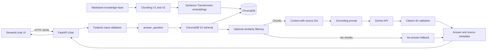

# Architecture & Engineering Decisions

## System goal

Build a small, multilingual retrieval-augmented assistant that answers IT-support questions from sample internal documentation while retaining evidence and exposing measurable failure modes.

## System components

## Retrieval design

- **Corpus:** Five fictional Markdown guides (`password_reset.md`, `vpn_access.md`, `email_support.md`, `device_setup.md`, `security_policy.md`).
- **V1:** Fixed 100-word windows with 20-word overlap.
- **V2:** Heading- and paragraph-aware chunks with included title/section context; long paragraphs are capped at 45 words with 8-word overlap.
- **Embedding model:** `sentence-transformers/paraphrase-multilingual-MiniLM-L12-v2`, 384-dimensional normalized vectors.
- **Storage:** ChromaDB `PersistentClient`, cosine distance. Returned similarity is computed as `1 - distance` and should not be interpreted as the probability of a correct answer.
- **RAG collection:** `it_knowledge_base_v2`, explicitly selected in `rag_service.py`.
- **Legacy search:** `/semantic-search` uses V1 by default. The project preserves V1 to compare chunking choices.

V2 differs from V1 in chunk boundaries **and** the contextual text embedded; any measured improvement cannot be attributed solely to chunk size.

## RAG pipeline

1. **Input validation:** FastAPI/Pydantic validates `question` and `top_k` (1–20).
2. **Retrieval:** Embed the question and retrieve up to `top_k` passages from ChromaDB V2.
3. **Guardrails:** Remove empty passages and, when configured, apply `RAG_MIN_SIMILARITY`.
4. **Fallback:** If no chunks remain, return a no-answer response without calling Gemini.
5. **Context assembly:** Tag usable passages as `S1`, `S2`, etc., retaining file name and chunk index.
6. **Prompt construction:** Instruct Gemini to answer in Vietnamese using the provided context, cite source IDs, and say when evidence is insufficient.
7. **Generation:** Call the Gemini API with the assembled prompt.
8. **Citation-ID check:** Accept referenced IDs only when they exist in the retrieved source list; an absent or invalid citation produces a fallback. This is **not** claim-level fact-checking.
9. **Output:** Return `question`, `answer`, `sources`, and `model` via `POST /chat`.

## Architectural boundaries

| Layer | Responsibilities | Main file |
| --- | --- | --- |
| Presentation | Render messages, sidebar controls, local session history | `frontend/streamlit_app.py` (tested locally) |
| API | HTTP validation, chat response schema, provider-error translation | `app/main.py`, `app/schemas/chat.py` |
| RAG application | Retrieval → context → prompt → model → guardrails | `app/services/rag_service.py` |
| Retrieval | Query embedding and ChromaDB access | `app/services/chroma_search.py` |
| Persistence | Local persistent vector collections | `app/services/vector_store.py` |
| Evaluation | Retrieval and RAG diagnostic metrics | `evals/`, `scripts/evaluate_rag.py` |

Frontend session history is a **display/history feature**, not automatically a multi-turn RAG conversation: the current `/chat` request carries one question at a time.

## Trade-offs

### Local embedding + remote generation

**Advantages:** Reproducible local retrieval; straightforward prompt integration; multilingual support.

**Costs:** Model download and CPU inference on the local machine; Gemini network/API availability and usage limits; external processing of the prompt context.

### ChromaDB as a local vector store

**Advantages:** Simple persistent prototyping without managing a remote vector DB.

**Limitations:** No document-level access control or tenant separation; index synchronization needs care. The V1 updater may retain removed source records, while the V2 build script clears and rebuilds its own collection.

### Similarity threshold

`RAG_MIN_SIMILARITY` is optional and may be left blank. A threshold reduces some irrelevant retrieval but can incorrectly discard answer-bearing passages. An out-of-scope question about an unknown VPN password scored relatively high in the recorded evaluation; score alone is not an adequate answerability decision.

### Citation validation

The current regex validates references such as `[S1]` against the IDs in the source list. It does **not** verify whether the cited passage entails the generated claim. Claim-level evidence checking and human review remain future work.

## Failure analysis from recorded evaluation

- **H12 (remote access):** The expected `vpn_access.md` was absent from top three retrieved passages. `device_setup.md` and `email_support.md` were returned; the system refused to answer. This illustrates retrieval recall failure rather than knowledge-base absence.
- **H11 (locked account):** Retrieved the expected `password_reset.md` and used valid citation IDs but began with a statement that it lacked enough information to name the contact. The source document includes Helpdesk contact guidance, so completeness should be reviewed manually.
- **N03 (specific executive VPN password):** Returned an appropriate no-answer despite a high-scoring retrieved passage. This is a useful reminder that semantic similarity and answerability are different concepts.

## Scope and future improvements

**Not implemented as enterprise production controls:** Authentication, permission-aware retrieval, secret management, tenant isolation, rate limiting, audit trails, and full observability. Never upload real confidential documents or credentials to this sample application.

Potential improvements, prioritized: (1) expand passage-level evaluation and diagnose H12; (2) enforce stronger factual/citation grounding; (3) design access-aware retrieval; (4) add multi-turn conversation context; (5) package/deploy when operational requirements justify it.
